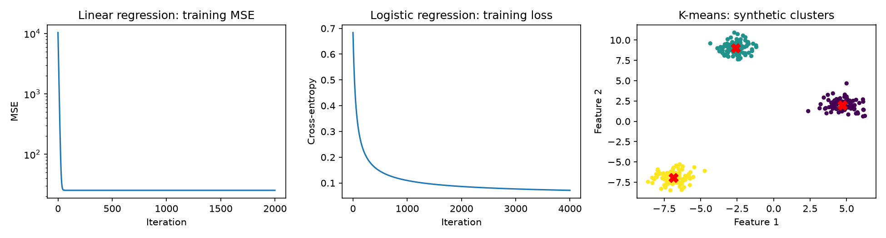

# ML Fundamentals with NumPy

Four classical machine-learning algorithms implemented with NumPy, with executable
comparisons against scikit-learn and tests for mathematical and API behavior.

This educational project favors readable implementations with explicit
limitations. Scikit-learn is used as a reference in
experiments and tests, not inside the NumPy estimators.

## Implementations

| Algorithm | Objective / rule | Important design choice |
| --- | --- | --- |
| Linear regression | Minimize mean squared error with full-batch gradient descent | Learns an intercept; scale features and choose a suitable step size |
| Logistic regression | Minimize binary cross-entropy | Stable sigmoid and log-loss; binary labels 0 and 1; no regularization |
| K-nearest neighbors | Majority vote among Euclidean nearest neighbors | Smallest label breaks class ties; training order breaks distance ties |
| K-means | Minimize within-cluster squared distances with Lloyd updates | Seeded random initialization, multiple restarts, retain empty-cluster centers |

## Run

Requires Python 3.12. From this repository directory:

```bash
python -m venv .venv
# Windows: .venv\Scripts\activate
# macOS/Linux: source .venv/bin/activate
python -m pip install -r requirements.txt
python -m pytest -q
python -m ml_fundamentals.experiment
```

The experiment writes `reports/metrics.json` and `reports/learning_curves.png`.
The committed report is an actual seeded run; rerunning regenerates it.

```python
from ml_fundamentals import LinearRegressionGD

model = LinearRegressionGD().fit([[0], [1], [2]], [1, 3, 5])
print(model.predict([[3]]))  # Approximately 7
```



## Evaluation

Synthetic regression and classification datasets use a 75/25 training/test split.
Feature scaling is fitted on training data only. Linear regression is compared
with ordinary least squares. Logistic regression is compared with a very weakly
regularized scikit-learn model (`C=1e8`), so it is an approximation to the same
objective. KNN uses the same neighbor count. K-means compares full-dataset inertia
and adjusted Rand agreement; those are clustering-fit comparisons, not test scores.

## Limitations

- These small implementations do not implement the scikit-learn estimator API.
- Gradient descent uses a fixed iteration count and may converge slowly on badly
  scaled data. Large finite values can still overflow arithmetic.
- KNN sorts all training distances per query: approximately O(n log n) per query,
  plus O(nd) distance computation. It is intended for small datasets.
- K-means can converge to local minima and may find fewer distinct clusters when
  points repeat. Its assignment matrix costs O(nkd) memory in this implementation.
- Synthetic experiments establish implementation behavior, not real-world utility.

## Study guide

Read [LEARNING_NOTES.md](LEARNING_NOTES.md), reproduce the results, and explain each
test before presenting the project in an interview. Suggested next work: derive
the gradients independently, add regularization, and compare convergence across
learning rates using training/validation data.

References: [scikit-learn linear models](https://scikit-learn.org/stable/modules/linear_model.html),
[nearest neighbors](https://scikit-learn.org/stable/modules/neighbors.html), and
[K-means](https://scikit-learn.org/stable/modules/clustering.html#k-means).
